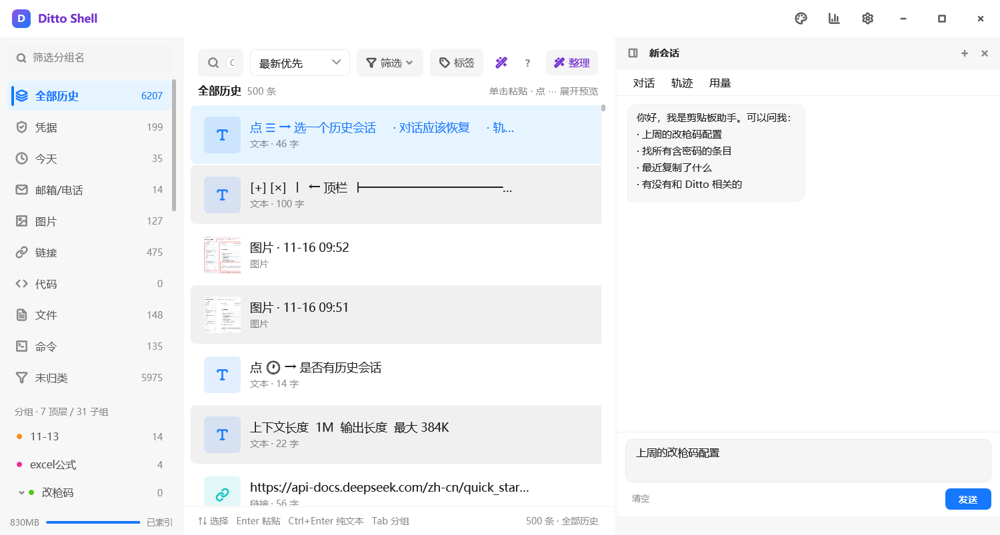

# DittoShell

> 给 [Ditto](https://github.com/sabrogden/Ditto) 剪贴板管理器做的现代界面外壳。
> **不改 Ditto 本体** —— Ditto 继续在后台抓取和粘贴，DittoShell 只做前端。

<p align="center">
  
</p>

---

## 为什么做这个

Ditto 是一款优秀的 Windows 剪贴板管理器，但界面停留在 Win32 时代：分组只能靠右键菜单、搜索只能纯文本、没有标签体系。

DittoShell 在**完全不修改 Ditto** 的前提下，给它补上：

- 现代的三栏界面（分组 / 列表 / 详情）
- 真正的标签系统（多对多，可筛选）
- 智能分类（代码 / 链接 / 凭据 / 图片 / 命令…自动识别）
- 可选 AI 检索与整理（DeepSeek API，默认关闭）

---

## 功能

### 界面

- **三栏布局**：左侧分组树 / 中间条目列表 / 右侧详情预览
- **可拖动分隔条**：三栏宽度都能调，重启后记住
- **快速面板**：`Ctrl+`` 唤出迷你窗口，不打断当前工作
- **两种主题**：浅色 / 深色

### 搜索

| 语法 | 说明 |
|---|---|
| `关键词` | 全文搜索 |
| `#1234` | 按条目 ID 精确查找 |
| `tag:工作` | 按标签筛选 |
| `from:chrome` | 按来源程序筛选 |
| 多个条件 | 空格分隔 = AND |

### 分组

- 无限层级（组 / 子组 / 孙组…）
- 树形连接线（`├─` `└─`）+ 字号分级
- 拖动排序、拖动条目进组
- 导出分组为 JSON / 纯文本
- 右键支持：重命名 / 新建子组 / 复制组名 / 组内搜索 / 清空 / 删除

### 智能分类

自动把条目分到 9 个类型：

| 类型 | 识别依据 |
|---|---|
| 代码 | 括号配平、关键字、缩进 |
| 链接 | URL 正则 |
| 凭据 | `sk-` / `ghp_` / `password=` 等模式 |
| 命令 | `$` / `>` / `PS ` 开头 |
| 图片 | 数据库中的 CF_DIB 格式 |
| 文件 | 路径特征 |
| 长文本 | 长度 > 500 字符 |
| 邮箱/电话 | 正则 |
| 文本 | 其余 |

### 隐私

- 标记为隐私的条目：**列表打码**（保留头尾）、**AI 不可见**
- 预览区可临时「查看原文」
- 独立的「隐私」分类

### AI（可选）

**默认关闭**，需要自己填 API Key。

| 功能 | 说明 |
|---|---|
| 对话检索 | 自然语言找条目（如「上周的改枪码」） |
| 智能整理 | AI 分析样本 → 生成分类方案 → 你确认 → 批量归类 |
| 摘要 | 对单条内容做 AI 摘要 |
| 标签建议 | 自动推荐标签 |

支持 **DeepSeek API**（`deepseek-flash` / `deepseek-v4-pro`）。

---

## 系统要求

| 项 | 要求 |
|---|---|
| 操作系统 | Windows 10 1809+ / Windows 11 |
| 运行时 | [.NET 8 Desktop Runtime](https://dotnet.microsoft.com/download/dotnet/8.0)（x64） |
| Ditto | **已安装并运行中**（[下载地址](https://ditto-cp.sourceforge.io/)） |

> DittoShell 通过只读方式读取 `Ditto.db`，通过 `Ditto.exe /paste:<id>` 执行粘贴。**不会修改 Ditto 的任何文件**。

---

## 下载

从 [Releases](../../releases) 下载最新版本：

| 文件 | 说明 |
|---|---|
| `DittoShell-v1.0.0-win-x64.zip` | 完整版（含 .NET 运行时，约 70MB） |

解压到任意目录，双击 `DittoShell.exe` 即可。

---

## 使用

### 首次启动

1. 确保 **Ditto 正在运行**
2. 启动 `DittoShell.exe`
3. 程序会自动探测 Ditto 的安装位置和数据库
4. 探测失败时，在「设置 → Ditto 设置」里手动指定路径

### 快捷键

| 快捷键 | 功能 |
|---|---|
| `Ctrl+`` | 唤出快速面板 |
| `Ctrl+K` | 聚焦搜索框 |
| `Enter` | 粘贴选中条目 |
| `Ctrl+Enter` | 纯文本粘贴 |
| `Delete` | 删除选中条目 |
| `Shift+↑/↓` | 多选 |
| `Esc` | 关闭预览 / 退出 |

### 隐私与数据

DittoShell 产生的数据全部在程序目录下：

```
DittoShell/
├── data/
│   ├── sidecar.db      # 标签、AI 会话、整理记录（你自己的数据）
│   ├── config.json     # 界面配置
│   └── menu.log        # 调试日志
└── backup/             # 修改 Ditto.db 前的自动备份
```

**不会上传任何数据**，除非你主动使用 AI 功能（那时只发送你选中的条目内容）。

---

## 构建

```bash
# 需要 .NET 8 SDK
git clone https://github.com/hanqingyan3293/ditto-shell.git
cd ditto-shell
dotnet build src/DittoShell.sln -c Release
```

产物在 `src/DittoShell.App/bin/Release/net8.0-windows/`。

### 打包发布版

```powershell
# 单文件 + 自包含（含运行时）
dotnet publish src/DittoShell.App/DittoShell.App.csproj `
  -c Release -r win-x64 --self-contained true `
  -p:PublishSingleFile=true `
  -o publish
```

---

## 技术架构

```
┌─────────────────────────────────────────┐
│  DittoShell.App (WPF)                   │  ← 界面层
│  ├─ Views/        XAML 视图             │
│  ├─ ViewModels/   MVVM                  │
│  └─ Services/     DI、窗口、主题         │
├─────────────────────────────────────────┤
│  DittoShell.Application                 │  ← 业务逻辑
│  ├─ AiAgentService    多轮对话 + 工具调用 │
│  ├─ AiTools           19 个 AI 工具定义  │
│  ├─ OrganizeRunner    批量整理           │
│  └─ GroupOpsService   分组导出/排序       │
├─────────────────────────────────────────┤
│  DittoShell.Infrastructure              │  ← 数据访问
│  ├─ DittoDbReader    只读 SQLite         │
│  ├─ DittoDbWriter    写（带备份）        │
│  ├─ SidecarStore     旁路库（标签等）    │
│  └─ Classification   类型识别            │
├─────────────────────────────────────────┤
│  DittoShell.Domain                      │  ← 模型 + 接口
└─────────────────────────────────────────┘
          │                        │
          ▼ 只读                   ▼ 命令行 / 窗口消息
    ┌──────────┐            ┌──────────────┐
    │ Ditto.db │            │  Ditto.exe   │
    └──────────┘            └──────────────┘
```

### 关键设计

| 决策 | 原因 |
|---|---|
| **不改 Ditto 源码** | 178 个 MFC 文件，重编译成本过高 |
| **SQLite 只读**（`mode=ro`） | Ditto 运行时也能安全读 |
| **旁路库**存标签 | 不动 Ditto 表结构 |
| **写入前强制备份** | 每次改 `Ditto.db` 前自动复制到 `backup/` |
| **写白名单** | 只允许改 `mText` / `ooData` / `lParentID`，且用事务 |

---

## 已知问题

| 问题 | 状态 |
|---|---|
| 右键菜单在某些位置出现在鼠标**左侧**而非右下 | ⚠️ 已知，见 [交接文档](docs/右键菜单定位问题-交接文档.md) |
| 二级菜单（`组 → 移到分组`）向右展开的判定偶有偏差 | ⚠️ 同上 |
| 排序偏好不持久化（重启恢复默认） | 📋 待做 |

欢迎 PR 修复。

---

## 贡献

1. Fork 本仓库
2. 从 `main` 拉分支：`git checkout -b feature/your-feature`
3. 提交：`git commit -m "feat: 你的功能"`
4. Push 并开 PR

**代码风格**：
- C# 遵循 `.editorconfig`
- XAML 缩进 2 空格
- 提交信息用中文或英文均可，前缀 `feat:` / `fix:` / `docs:` / `refactor:`

---

## 致谢

- [Ditto](https://github.com/sabrogden/Ditto) — Scott Brogden，GPL v3
- [CommunityToolkit.Mvvm](https://github.com/CommunityToolkit/dotnet) — MVVM 基础设施
- [HtmlRenderer.WPF](https://github.com/thomasjo/HtmlRenderer.WPF) — 富文本渲染

---

## 许可

[GPL v3](LICENSE) — 与 Ditto 保持一致。

> 本项目是独立前端，不包含 Ditto 的任何代码，仅通过公开的数据库格式和命令行接口与之交互。
